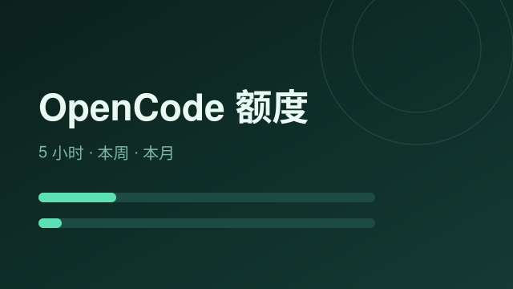

# OpenCode 额度

一个 Hana v2 App。打开卡片就能看到 OpenCode Go 计划的额度用量，不用再登录网页控制台。



## 它显示什么

三个进度条，对应 OpenCode 的三档额度窗口：

| 窗口 | 含义 |
|---|---|
| 5 小时 | 滚动窗口，占月额度的 20%，用满会立刻卡住 |
| 本周 | 占月额度的 50% |
| 本月 | 月额度基准，100% |

每条下面跟着一个实时倒计时，告诉你还有多久重置。用量过 70% 转黄，过 90% 转红，阈值可以在设置里改。

副标题会主动指出当前最紧的是哪个窗口，省得你自己比较三个数。

## 它同时是一个工具

除了卡片，它还注册了一个 `opencode_quota` 工具给 Agent 用。意义在于：人看到 62% 只能决定“省着点”，Agent 看到同一个数能决定“这个任务换便宜模型跑，把额度留给关键判断”。

在 Hana 设置里给对应 Agent 开启这个 App 的工具权限后，Agent 就能在跑长任务前自己先查一次。

## 安装

1. 在 Hana 的应用管理里导入这个目录，或 `dist/` 下的安装包
2. 确认安装卡（它只申请两样：访问 `opencode.ai` 一个域名、把工具暴露给模型）
3. 打开 Hana 设置页，左侧导航里找「OpenCode 额度」，把 API key 填进去

## 拿 API key

登录 [opencode.ai/console](https://opencode.ai/console)，账户菜单里找 **Personal API keys**，新建一把：

- 权限选只读
- 有效期按需选，30 天也够用，到期重建即可

只要额度读取权限，不需要付费、预算或写权限。

## 数据从哪来

`GET https://opencode.ai/zen/go/v1/usage`，Bearer 认证，返回三段窗口的百分比和重置时间。

**这个端点没有官方文档。** 官方公开的 Console API 只有 budgets 那一条（见 [opencode.ai/v2/docs/console/api](https://opencode.ai/v2/docs/console/api)），返回的是月度花费而不是套餐窗口；套餐窗口的接口只喂给控制台页面，社区是从页面实现里摸出来的（相关请求：[anomalyco/opencode#31084](https://github.com/anomalyco/opencode/issues/31084)）。

所以它随时可能变。这个 App 的设计原则是：**接口一坏就明确说坏了，不拿上一次的数据装作还在工作。**

## 已知的边界

- **只有百分比，没有金额。** 端点不返回美元数，所以做不出“还剩 12 美元”。
- **没有按模型的明细。** 传 `?model=` 参数无效，返回的始终是套餐整体视角。文档里额度是按模型定义的，但接口层面拿不到那个切面。
- **额度面板显示的是套餐视角**，跟你网页控制台看到的三档是同一组数。

## 错误怎么读

卡片不会只说“失败”，每种失败都有对应的话：

| 代码 | 意思 |
|---|---|
| `NO_KEY` | 还没填 key |
| `KEY_MALFORMED` | 那一栏里有中文或全角符号，不像 key（会指出是第几个字符） |
| `KEY_MASKED` | 读到的是 `********` 掩码，真正的值没存进去 |
| `KEY_INVALID` | 401，key 失效或过期 |
| `NO_SUBSCRIPTION` | 403，这把 key 没有 Go 计划权限 |
| `ENDPOINT_MOVED` | 404，接口搬家了，需要更新这个 App |
| `NETWORK` | 请求真的没发出去 |

## 设置项

| 字段 | 说明 |
|---|---|
| `apiKey` | OpenCode API key，敏感字段，读回时宿主会掩码 |
| `warnPercent` | 转黄阈值，默认 70 |
| `dangerPercent` | 转红阈值，默认 90 |

## 开发

```sh
# 静态校验
node <hana-app-creator>/scripts/validate_app.mjs --dir . --json

# 启动冒烟（需要 Electron 运行时）
node <hana-app-creator>/scripts/validate_app.mjs --dir . --smoke --json

# 打包
node <hana-app-creator>/scripts/pack_app.mjs --dir . --publisher "You" --out ./dist
```

目录结构：

- `index.js` 后端入口：取数、错误分类、注册工具与路由
- `ui/panel.html` + `ui/assets/panel.js` 卡片界面
- `sdk/` 随包携带的 Hana App SDK，运行时不依赖宿主 `node_modules`

## 许可

MIT
