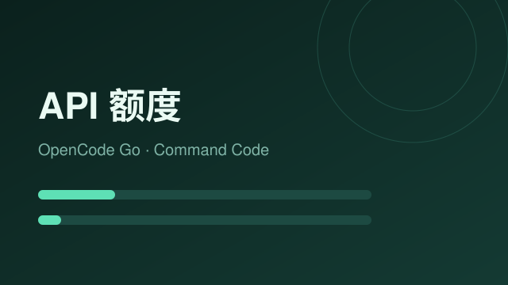

# API 额度

一个 Hana v2 App。打开卡片就能看到手上几家 AI 编码服务的额度用量，不用再逐个登录网页控制台。



## 支持的服务

| 服务 | 额度窗口 | 额外信息 |
|---|---|---|
| **OpenCode Go** | 5 小时 / 本周 / 本月 | 纯百分比，无金额 |
| **Command Code** | 5 小时 / 本周 / 本月 | 剩余余额、当前套餐、周期结束时间 |

两段上下排列，各自独立取数：某一家没配 key 或接口出错，另一家照常显示。

## OpenCode Go 显示什么

三个进度条，对应三档额度窗口：

| 窗口 | 含义 |
|---|---|
| 5 小时 | 滚动窗口，占月额度的 20%，用满会立刻卡住 |
| 本周 | 占月额度的 50% |
| 本月 | 月额度基准，100% |

每条下面跟着倒计时，告诉你还有多久重置。用量过 70% 转黄，过 90% 转红，阈值可在设置里改。

## Command Code 显示什么

两个窗口进度条（5 小时 / 本周），再加一条本月的金额进度：

- **本月**这一行不是接口直接给的窗口，而是 `已用金额 ÷（已用 + 剩余）` 算出来的池子
- 标题右侧同时显示余额和套餐名，例如 `余额 $38.20 / $60.00，套餐 pro`
- 订阅周期结束时重置

窗口空着（`used = 0` 且没有排定的重置点）时，倒计时位置写「未开始」，不当成数据缺失。

## 它同时是一个工具

除了卡片，它还注册了一个 `api_quota` 工具给 Agent 用。意义在于：人看到 62% 只能决定「省着点」，Agent 看到同一个数能决定「这个任务换便宜模型跑，把额度留给关键判断」。

在 Hana 设置里给对应 Agent 开启这个 App 的工具权限后，Agent 就能在跑长任务前自己先查一次。

## 安装

1. 在 Hana 的应用管理里导入这个目录，或 `dist/` 下的安装包
2. 确认安装卡（它只申请两样：访问 `opencode.ai` 与 `api.commandcode.ai` 两个域名、把工具暴露给模型）
3. 打开 Hana 设置页，左侧导航里找「API 额度」，把要用的 key 填进去；只填一家也能跑

## 拿 key

**OpenCode**：登录 [opencode.ai/console](https://opencode.ai/console)，账户菜单里找 **Personal API keys**，新建一把。权限选只读，有效期按需选，30 天也够用，到期重建即可。不需要付费、预算或写权限。

**Command Code**：在 commandcode.ai 后台建 key，通常以 `user_` 开头。卡片会先用它请求 `/alpha/whoami` 确认身份，再取额度。

## 数据从哪来

**OpenCode**：`GET https://opencode.ai/zen/go/v1/usage`，Bearer 认证，返回三段窗口的百分比和重置时间。

**这个端点没有官方文档。** 官方公开的 Console API 只有 budgets 那一条（见 [opencode.ai/v2/docs/console/api](https://opencode.ai/v2/docs/console/api)），返回的是月度花费而不是套餐窗口；套餐窗口的接口只喂给控制台页面，社区是从页面实现里摸出来的（相关请求：[anomalyco/opencode#31084](https://github.com/anomalyco/opencode/issues/31084)）。

**Command Code**：`/alpha/*` 一组内测路由，四个请求：

| 路由 | 取什么 |
|---|---|
| `/alpha/whoami` | 组织 id 与账号，后续请求用它拼 `orgId` |
| `/alpha/billing/credits` | 剩余额度拆分（月付 / 购买 / 赠送）与窗口上限 |
| `/alpha/billing/subscriptions` | 套餐名、状态、当前计费周期起止 |
| `/alpha/usage/summary` | 周期内已用金额 |

同样是 `alpha` 前缀的未公开接口。这个 App 的设计原则是：**接口一坏就明确说坏了，不拿上一次的数据装作还在工作。**

## 已知的边界

- **OpenCode 只有百分比，没有金额。** 端点不返回美元数，做不出「还剩 12 美元」。Command Code 那边有金额。
- **没有按模型的明细。** 两家都只给账号整体视角，传 `?model=` 无效。文档里额度是按模型定义的，但接口层面拿不到那个切面。
- **Command Code 的四个请求里，三个是「失败就降级」**：余额、套餐、汇总任一拿不到，只是对应信息缺失，不会让整段变红；只有 whoami 失败才判定这一段不可用。

## 错误怎么读

卡片不会只说「失败」，每种失败都有对应的话：

| 代码 | 意思 |
|---|---|
| `NO_KEY` | 这一家还没填 key |
| `KEY_MALFORMED` | 那一栏里有中文或全角符号，不像 key（会指出是第几个字符） |
| `KEY_MASKED` | 读到的是 `********` 掩码，真正的值没存进去 |
| `KEY_INVALID` | 401，key 失效或过期 |
| `NO_SUBSCRIPTION` | 403，这把 key 没有对应计划权限 |
| `ENDPOINT_MOVED` | 404，接口搬家了，需要更新这个 App |
| `EMPTY_PAYLOAD` | 接口通了但没有可显示字段，多半是字段改名 |
| `NETWORK` | 请求真的没发出去 |

## 设置项

| 字段 | 说明 |
|---|---|
| `apiKey` | OpenCode API key，敏感字段，读回时宿主会掩码 |
| `commandCodeKey` | Command Code API key（`user_` 开头），留空则不显示这一段 |
| `warnPercent` | 转黄阈值，默认 70 |
| `dangerPercent` | 转红阈值，默认 90 |

## 开发

```sh
# 静态校验
node <hana-app-creator>/scripts/validate_app.mjs --dir . --json

# 启动冒烟（需要 Electron 运行时）
node <hana-app-creator>/scripts/validate_app.mjs --dir . --smoke --json

# 打包
node <hana-app-creator>/scripts/pack_app.mjs --dir . --publisher "You" --out ./dist
```

目录结构：

- `index.js` 后端入口：取数、错误分类、注册工具与路由
- `ui/panel.html` + `ui/assets/panel.js` 卡片界面
- `sdk/` 随包携带的 Hana App SDK，运行时不依赖宿主 `node_modules`

## 许可

MIT
